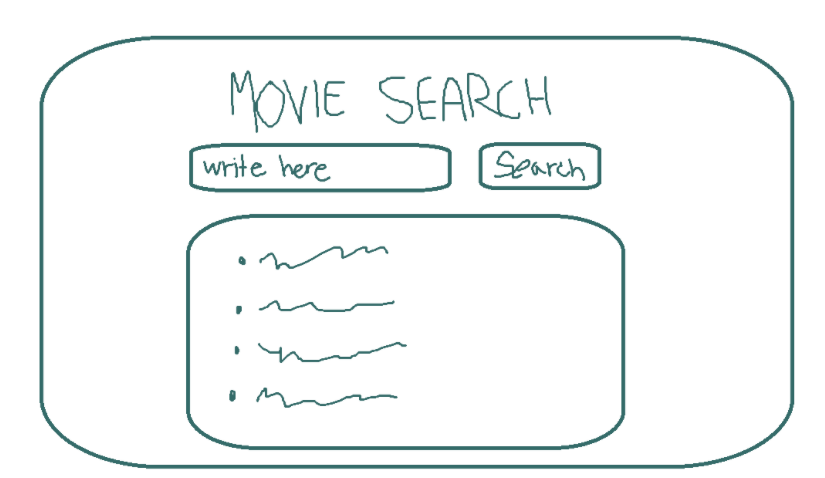
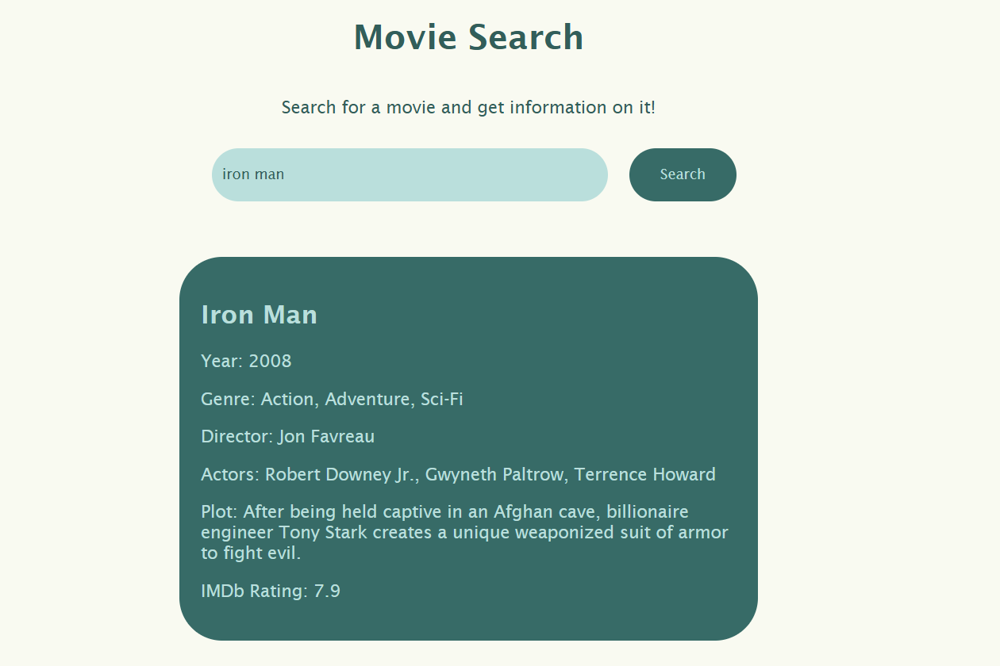

# Projektin nimi

**Tekijä(t):** Jessica Rusila

## Projektisuunnitelma

### Projektin idea

Sovelluksella käyttäjä voi etsiä elokuvia ja saada tietoa niistä kuten juoni, näyttelijät julkaisuvuosi jne.

### Suunnitellut toiminnot

Listaa vähintään kolme sovellukseesi suunniteltua toimintoa:

- Käyttäjä voi hakea elokuvaa nimellä
- Käyttäjä voi lukea tietoa hakemastaan elokuvasta
- Sovellus ilmoittaa, jos elokuvaa ei löydy

### Rautalankamalli / luonnos

## Verkkolinkit

- **Julkaistu sovellus:** [Lisää tähän GitHub Pages -osoite](https://jessrus.github.io/Projekti2/)
- **GitHub-repositorio:** [Lisää tähän repositorion osoite](https://github.com/JessRus/Projekti2.git)
- **Projektin videoesittely:** [Lisää tähän videon osoite](https://video.laurea.fi/media/PROJEKTI2/0_umqp8dj9)

## Tietoja sovelluksesta

**[Movie Search]** on verkkosovellus, jossa käyttäjä voi etsiä infoa haluamastaan elokuvasta.

## Teknologiat

Kuvaile, mitä teknologioita käytit ja mikä niiden rooli oli projektissasi.

- HTML – sivun rakenne
- CSS – ulkoasu ja asettelu
- JavaScript – toiminnallisuus, DOM-skriptaus ja lomakkeiden validointi

## Sovelluksen käyttö

Kirjoita lyhyet käyttöohjeet sovellukselle.

1. Avaa julkaistu sovellus yllä olevasta linkistä.
2. Laita oma apikey PUT_YOUR_API_KEY_HERE kohtaan.
3. Etsi tietoa haluamistasi elokuvista.

## Sovelluksen käynnistäminen paikallisesti

1. Kloonaa tai lataa tämä repositorio omalle koneellesi.
2. Avaa projektikansio.
3. Avaa `index.html` selaimessa.

## Kuvakaappaukset

## Tunnetut virheet / puutteet

**Ei tunnettuja virheitä.**

## Oma arvio ja oppimisen reflektointi

- Missä onnistuin? **Sain tehtyä ihan toimivan sovelluksen.**
- Mikä oli haastavaa? **Javascripti on minusta vieläkin vaikeaa.**
- Mitä parantaisin, jos aikaa olisi enemmän? **Projektini on aika simppeli oisin voinut keksiä vielä jotain lisättävää.**
- Mitä opin HTML:stä, CSS:stä, JavaScriptistä ja DOM-skriptauksesta? **Emme ole muissa kursseissa tutustuneet paljon apeihin, joten opin paljon siitä miten ne toimivat ja miten voi itse hyödyntää niitä.**
- Mikä jäi epäselväksi tai mistä haluaisin oppia lisää? **Javascript on vieläkin mielestäni vähän sekavaa ja en tajua kaikkea.**
- Oma arvio projektista: **6/10 pistettä**

## Lähteet ja kiitokset

- [Mitä api avainta käytin](OMDB API, http://www.omdbapi.com/)
- Käytetty tekoälytyökalu: ChatGPT
  - Miten työkalua käytettiin: Käytin tekoälyä korjaaman virheitä javascript koodissani ja ossittain parantamaan sitä.
